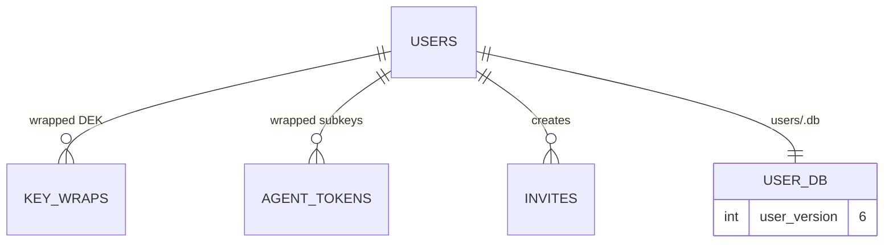
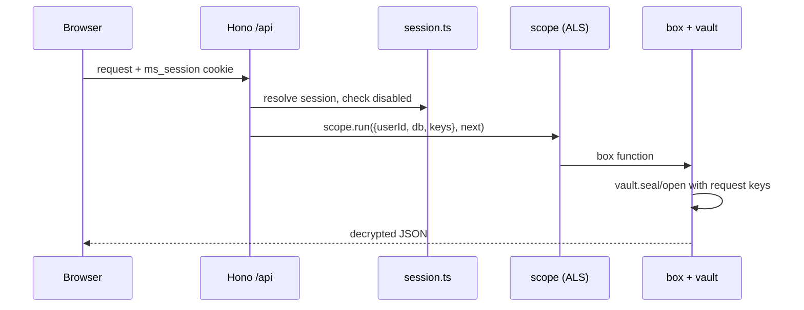
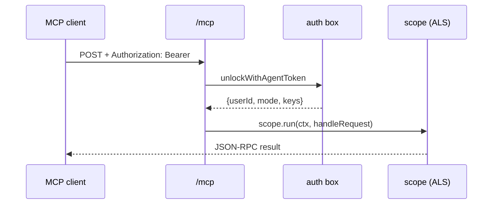

# AGENTS.md — ministudyui

Read this before exploring. Multi-user, per-user-encrypted build on branch `encrypted-multiuser`.

## What this is

A quiet study app: decks, flashcards, spaced repetition, quizzes, attempts, grading, stats.
One process serves two entry points over one shared core:

| Entry point | File | Role |
| --- | --- | --- |
| HTTP server (Bun) | `src/http/server.ts` | Web UI + JSON API, and `/mcp` |
| Shared core ("boxes") | `src/boxes/*/index.ts` | All business logic + SQLite access |

There is **no stdio MCP server** and no second process. `src/http/mcp.ts` mounts a stateless
Streamable HTTP MCP server at `/mcp` in the same process, so web live-updates fire when an
MCP tool mutates data. HTTP handlers and MCP registrations are thin adapters; domain logic
lives in boxes.

Storage: `<DATA_DIR>/auth.db` (users, invites, key wraps, agent tokens — own schema,
`user_version = 1`) and one `<DATA_DIR>/users/<numeric-id>.db` per user (the study schema,
`user_version = 6`). File names are numeric ids, never usernames. No `user_id` columns:
isolation comes from separate files. Username uniqueness, one-quiz-per-deck, `ui_context`
single row, `undo`, `restart` and the changefeed cursor are all per-user automatically.

### Storage map



### Web request to a box



### MCP request



## Commands (Bun only)

```sh
bun install
bun run seed              # create DATA_DIR + auth.db schema, NO users
bun run seed:demo         # create 'demo' user (DEMO_PASSPHRASE, insecure default) + sample data
bun run start             # build assets + start HTTP server (default 127.0.0.1:3000)
bun run dev               # watch server + rebuild SCSS
bun run user <cmd>        # local admin CLI (see below)
bun run backup            # VACUUM INTO backup of auth.db + every user DB
bun run migrate:legacy -- --user <name> [--legacy <path>] [--dry-run]
bun test
bun run typecheck
bunx sass web/scss:web/css --no-source-map
bun run assets
```

`bun run user` commands: `create`, `list`, `passwd`, `recovery-reset`, `invite-create`,
`invite-list`, `disable`, `enable`, `delete`, `token-create --user <n> --label <l> [--read-only]`,
`token-list`, `token-revoke --id <id>`, `export --user <n> [--out <file>]`.
Hidden prompts are used for secrets; `MINISTUDY_PASSPHRASE` allows non-interactive use.

## Environment (real env vars; `.env*` is NOT loaded)

| Variable | Default | Notes |
| --- | --- | --- |
| `DATA_DIR` | `<repo>/data` | Root for `auth.db` and `users/`. |
| `PORT` | `3000` | HTTP port. |
| `BIND_HOST` | `127.0.0.1` | Bind address. Defaults stay localhost-only. |
| `PUBLIC_ORIGIN` | unset | e.g. `https://study.example.com`; adds its host to `ALLOWED_HOSTS`, enables `Secure` cookie + HSTS when https. |
| `ALLOWED_HOSTS` | `127.0.0.1:<PORT>,localhost:<PORT>` + `PUBLIC_ORIGIN` host | Comma-separated Host header allow-list. |
| `TRUST_PROXY` | unset | Set to `1` to use `X-Forwarded-For` for throttling. |
| `SESSION_TTL_MINUTES` | `720` | Sliding idle TTL; sessions are memory-only. |
| `MAX_USER_DB_MB` | `512` | Write-time size cap per user DB. |
| `BACKUP_KEEP` | `14` | Number of timestamped backup directories to retain. |
| `MAX_OPEN_USER_DBS` | `32` | LRU cap for open per-user DB handles. |
| `DEMO_PASSPHRASE` | `insecure-demo-passphrase` | Used only by `seed:demo`. |
| `MINISTUDY_PASSPHRASE` | unset | Non-interactive CLI helper. |
| `AUTH_THROTTLE_BASE_MS` | `1000` | Test-only throttle tuning. |

## Layout

```
shared/            types.ts (type-only), schemas.ts (Zod v4 HTTP/import schemas)
src/boxes/
  store/           SQLite helpers, schema.sql (v6), migrations 1..6
  auth/            auth.db schema + identity, wraps, invites, agent tokens, throttling
  vault/           HKDF/HMAC/AES-GCM primitives, field seal/open, DEK wraps, base32
  scope/           AsyncLocalStorage<UserContext>, current()/run(), test fallback
  userdb/          per-user DB registry: lazy open, pragmas, LRU + leases
  library/         decks, cards, quizzes, questions, importBundle  ← field mappers
  study/           queue, review, undo, cardSchedule, stats, deckSummaries
  attempts/        start, get, restart, answer, submit, gradeAnswer, pending, list
  grader/ srs/ latex/   grading, scheduling, LaTeX validation
  context/         ui_context read/write/current (ids only; no encrypted text)
  changefeed/      change log + subscribe (SSE backing; re-enters scope on ticks)
  export/          plaintext bundle export
  errors.ts        AppError + codes -> HTTP status
src/http/
  app.ts           Hono app: all routes, middleware, security headers, config
  server.ts        opens auth.db, Bun.serve
  config.ts        env-driven network/session config
  session.ts       in-memory sessions (keys live here only)
  mcp.ts           /mcp bearer-token auth + stateless Streamable HTTP transport
  static.ts        web/ + shared/ + vendor JS, path-traversal guard
  validate.ts      Zod validator wrapper
src/mcp/tools.ts   tool registration (shared by /mcp; read-only mode)
web/               browser app, no bundler; see below
scripts/           seed, seed-demo, user, backup, migrate-legacy, smoke, build-assets
test/              bun:test + node:test suites, mechanical security tests, fixtures
```

## Conventions and gotchas

- **Imports use `.js` extensions** for local TS. `shared/types.ts` must stay type-only (web uses `import type`). Boxes import it as `../../../shared/types.js`, HTTP/MCP as `../../shared/types.js`.
- **Naming boundary:** boxes take camelCase; HTTP JSON and MCP args use snake_case; adapters map.
- **Shell menus:** new account or utility actions go in the shared `web/shell-menu.ts` definition so the desktop popover and mobile sheet stay in sync.
- **Scope:** every box function resolves its DB via `store.run/get/all/count/tx` → `scope.current()`. A missing scope throws `UNAUTHENTICATED`. Tests call `store.open(':memory:')`, which installs a fixed-key test fallback; production never opens in-memory DBs. Long-lived async work (SSE timers) captures the context at subscribe time and re-enters `scope.run` on every tick.
- **Vault:** `vault.seal(table,column,value)` / `vault.open(...)` use `scope.current().keys.enc`, AAD `table.column`, format `enc1:` + base64url(nonce‖ct‖tag). `vault.indexValue(lowercase)` derives the blind index for `decks.name_key`. Only `node:crypto` primitives. No custom crypto.
- **Adding a content column checklist:** (1) add `vault.seal` on every INSERT/UPDATE and `vault.open` on every SELECT in the owning box, including import/export, update and search paths; (2) remove any DB `CHECK (length(...))` / `json_valid(...)` on the encrypted column (ciphertext is larger); (3) add the column to `ENCRYPTED` in `test/encryption.test.ts` and add a canary to `writeAllCanaries`; (4) if it needs lookup/sort, add a blind index or JS-side sort; (5) re-run typecheck + tests + crypto review.
- **Plaintext metadata (documented):** ids, positions, timestamps, SRS numerics/`due_at`, `ignored`, ratings, `prev_state_json`, `question_order_json`, question kind, status, scores, `graded_by`, `source`, counts, `decks.name_key`.
- **Schema/migrations:** `schema.sql` is the v6 base; migrations in `store.migrate()` are guarded and never renumber. Opening a v1–v5 user DB as a normal user DB is an error; only `migrate:legacy` may read it. DB columns are snake_case; JS writes ISO timestamps.
- **Constraints:** deck names unique via blind index `name_key` (NOCASE semantics replicated in JS); one quiz per deck; questions unique per `(quiz_id, position)`; answers unique per `(attempt_id, question_id)`.
- **Errors:** `AppError(code, ...)`. Codes include `UNAUTHENTICATED` → 401. `FORBIDDEN` → 403. HTTP envelope `{code,message,field?,hint?}`.
- **Auth:** invite-only registration. `setup` only with zero users (first user is admin). Admins manage accounts but never see other users' content or keys. Sessions are memory-only; logout/t TTL/disable clears them. Login throttling per username + IP with identical unknown-user/wrong-passphrase responses.
- **MCP:** `/mcp` uses `Authorization: Bearer msk_<tokenId>.<secret>` only (never query strings), validates Origin when present, has per-IP failed-auth throttling and per-token body/rate limits, and is stateless (`enableJsonResponse`, no session id). GET/DELETE → 405. A read-only token does not register mutating tools. A web-session cookie does not authenticate `/mcp`. Tool names/descriptions/input schemas are pinned by `test/fixtures/mcp-tools.snapshot.json`.
- **Web:** no bundler. `index.html` import map + hashed CSP; module scripts are `.js` URLs transpiled from `.ts` on request. `?mock=1` and `?mock=1&auth=locked` keep working; edit SCSS, never generated CSS (`web/scss/app.scss` is orphaned).
- **Security:** Host/Origin allow-list on every request; CSP (`script-src 'self' 'sha256-<importmap>'`, no unsafe-inline), `nosniff`, `no-referrer`, `X-Frame-Options: DENY`, HSTS when https. Mutating `/api` routes require JSON content-type and have a 2 MiB cap. Never log secrets; redact `Authorization`/`Cookie`.

## HTTP routes (`src/http/app.ts`)

Public: `GET /api/auth/status`, `POST /api/auth/{setup,login,logout,recover,register}`.
Admin (session + admin): `/api/admin/users` GET, `/api/admin/invites` GET/POST,
`PATCH /api/admin/users/:id`, `DELETE /api/admin/users/:id`.
Session-only: `/api/agent-tokens` GET/POST, `DELETE /api/agent-tokens/:id`, `GET /api/export`,
`/api/events` (SSE), decks/cards/review/quizzes/import/attempts/grading/stats/latex/ui-context
as before. `POST /mcp` is the MCP endpoint (bearer auth, not a cookie route).

## Tests

`bun test`: scope, vault primitives (RFC 5869 KATs), auth, HTTP auth/security, MCP parity/auth,
encryption canary + column coverage, export round trip, migration, plus the original smoke/http/
context/schedule/markdown suites. Gate: `bun run typecheck && bun test`. No linter configured.
