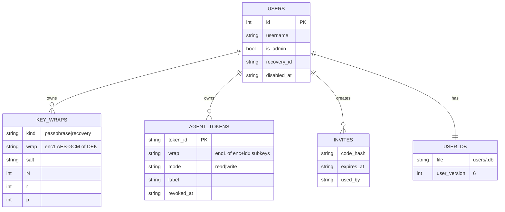
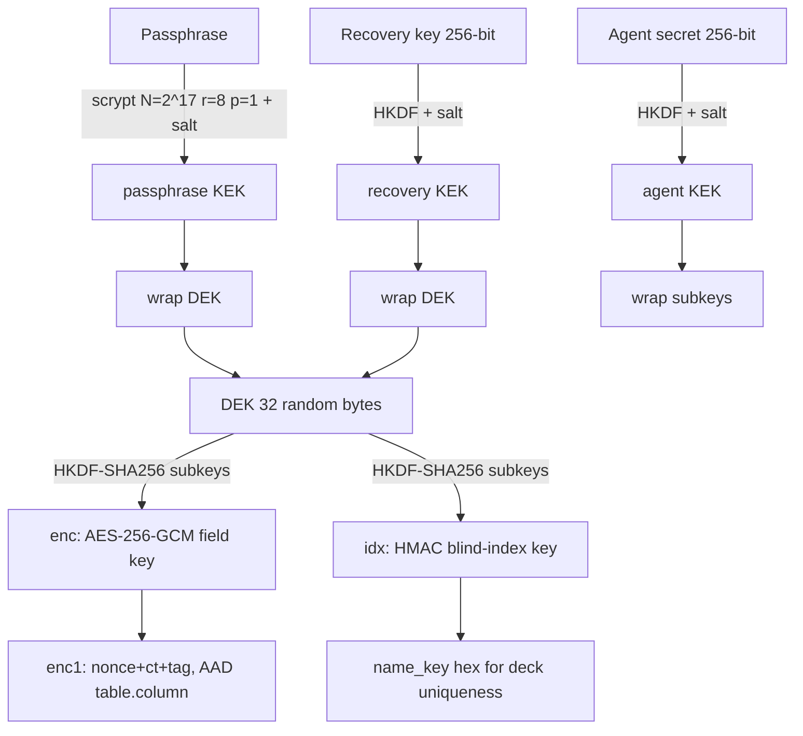
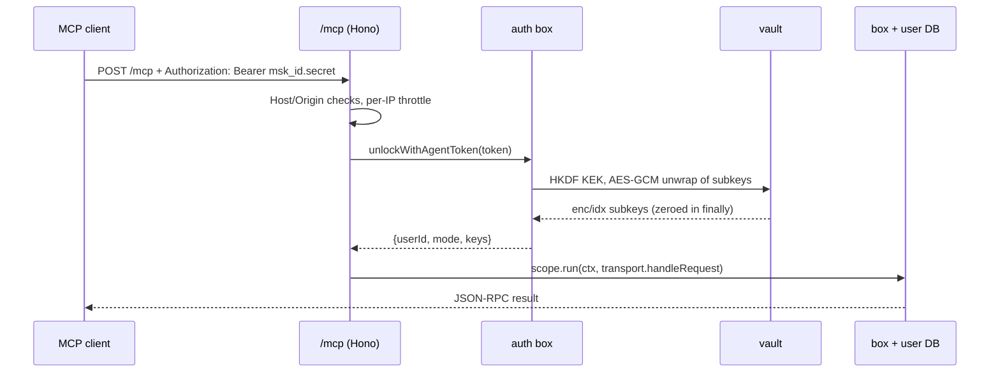

# ministudyui

A quiet study app for decks, spaced repetition, quizzes, attempts, grading and stats —
now with **per-user encryption**, invite-only multi-user accounts, and MCP over Streamable
HTTP. One Bun process serves the web UI/API and `/mcp`; all domain logic lives in shared
"boxes". All state lives under `DATA_DIR` (default `<repo>/data`).

## Quick start (owner)

```sh
git switch encrypted-multiuser
bun install
bun run seed                    # creates <DATA_DIR>/auth.db, no users
bun run migrate:legacy -- --user <your-name>   # prompts for a passphrase; prints recovery key ONCE
bun run start                   # http://127.0.0.1:3000
```

Open the URL. On first boot the Setup screen also offers to create the first account and
shows the recovery key once. The first user is the admin. If you have no legacy data, use
the Setup screen (or `bun run user create --user <name>`) instead of `migrate:legacy`.

**Save the recovery key offline.** It is the only way back if you lose your passphrase.
Losing both means your data cannot be recovered. The registration screen says this plainly.

### What is stored



`auth.db` holds identities, wrapped keys, invite hashes and token wraps — never study
content or unwrapped keys. Each `users/<id>.db` holds that user's decks, cards, SRS state,
quizzes, questions, attempts and answers; its `user_version` is 6.

### Key hierarchy



Passphrase change and recovery reset only **rewrap the DEK**; no data is re-encrypted.
Ciphertext is versioned (`enc1:`). Subkeys are derived with HKDF-SHA256; there is no custom
cryptography — only `node:crypto` primitives.

## Run the web app

```sh
bun run start
# edit-time: bun run dev (server --watch + SCSS watch)
```

`web/css/` and `web/og-image.png` are generated and gitignored; SCSS in `web/scss/` is the
source. `bun run start` builds brand assets but not CSS — build it once with
`bunx sass web/scss:web/css --no-source-map` or use `bun run dev`. `web/messages.json` holds
user-facing copy. Content renders Markdown with raw HTML escaped, links restricted to
http(s)/mailto, and LaTeX via KaTeX.

## Accounts, invites and admin

- **First run:** Setup creates the first user (admin) and shows the recovery key once.
- **More users:** admin panel → *create invite* → copyable link. Registration is
  invite-only (`POST /api/auth/register`); there is no open-registration flag. Invites are
  single-use, expire, and are stored only as a hash.
- **Admin panel** (admins only): list users, disable/enable/delete. Admins manage accounts
  but **cannot read another user's content or keys**. Disabling invalidates sessions and
  agent tokens. Deleting a user removes their DB file and wraps.
- **CLI:** `bun run user list|create|passwd|recovery-reset|invite-create|invite-list|
  disable|enable|delete|token-create|token-list|token-revoke|export`. Secrets use hidden
  prompts; `MINISTUDY_PASSPHRASE` is accepted for non-interactive use.

Login is throttled per username and per IP with identical errors for unknown users and
wrong passphrases (a dummy KDF equalizes timing). Passwords must be at least 10 characters;
there are no composition rules. Sessions live in memory only (sliding
`SESSION_TTL_MINUTES`, default 720); a restart logs everyone out. `ms_session` is
`HttpOnly; SameSite=Strict; Path=/`, and adds `Secure` when `PUBLIC_ORIGIN` is https.

## Connect an MCP client

MCP is served from the same process at `/mcp` (stateless Streamable HTTP, JSON responses).
It is **bearer-token only** — a web-session cookie does not authenticate it. Create a token
in the web UI (*more* sheet → Agent access) or via
`bun run user token-create --user <name> --label <label> [--read-only]`. Prefer **read-only**:
card text is untrusted input to an LLM. The token is shown once; only its wrap is stored.



OpenCode (v2 config, verified against installed v2.3.2 — uses `mcp.servers` and
`oauth: false` for header auth):

```jsonc
{
  "$schema": "https://opencode.ai/config.json",
  "mcp": {
    "servers": {
      "ministudyui": {
        "type": "remote",
        "url": "http://127.0.0.1:3000/mcp",
        "oauth": false,
        "headers": { "Authorization": "Bearer {env:MINISTUDY_AGENT_TOKEN}" }
      }
    }
  }
}
```

The repo's `opencode.json` is already set up for local dev this way. For another client,
Claude Code style (verify flags against current docs):

```sh
claude mcp add --transport http ministudyui https://study.example.com/mcp \
  --header "Authorization: Bearer $MINISTUDY_AGENT_TOKEN"
```

`/mcp` validates `Origin` when present (DNS-rebinding defense), never accepts tokens in
URLs, has a body-size cap and failed-auth throttling, and returns 401 with
`WWW-Authenticate: Bearer` on any auth failure. `GET`/`DELETE` return 405. Read-only tokens
do not even register mutating tools. **Connectors that only speak OAuth are not supported**;
OAuth is a possible future phase.

### Request/scope flow for the web UI

```mermaid
sequenceDiagram
    participant Browser
    participant App as Hono /api
    participant Session as session.ts
    participant Auth as auth box
    participant Scope as scope (ALS)
    participant Box as library/study/attempts
    Browser->>App: POST /api/auth/login (passphrase in JSON body only)
    App->>Auth: login(username, passphrase, ip)
    Auth-->>App: {userId, keys}
    App->>Session: create session (keys in memory only)
    App-->>Browser: Set-Cookie ms_session (HttpOnly, SameSite=Strict)
    Browser->>App: /api/... + cookie
    App->>Session: resolve session + check disabled
    App->>Scope: scope.run({userId, db, keys}, next)
    Scope->>Box: box function
    Box->>Box: vault.seal/open with request keys
    Box-->>Browser: JSON (decrypted content)
```

A 401 from any API call shows the auth gate, closes SSE and clears UI state.

## Hosting for others

Defaults are localhost-only and safe. To expose the app, terminate TLS at a reverse proxy
and set `PUBLIC_ORIGIN` to the external https URL.

| Variable | Default | Purpose |
| --- | --- | --- |
| `DATA_DIR` | `<repo>/data` | Root for `auth.db` and `users/`. |
| `PORT` | `3000` | HTTP port. |
| `BIND_HOST` | `127.0.0.1` | Bind address. |
| `PUBLIC_ORIGIN` | unset | External https origin; enables `Secure` + HSTS. |
| `ALLOWED_HOSTS` | localhost/127.0.0.1 + `PUBLIC_ORIGIN` host | Host allow-list. |
| `TRUST_PROXY` | unset | `1` = use `X-Forwarded-For` for throttling (proxy must overwrite it). |
| `SESSION_TTL_MINUTES` | `720` | Sliding session idle TTL. |
| `MAX_USER_DB_MB` | `512` | Per-user DB write cap. |
| `BACKUP_KEEP` | `14` | Backup directories retained. |
| `MAX_OPEN_USER_DBS` | `32` | LRU cap for open user DB handles. |

**Caddy** (example; set `PUBLIC_ORIGIN=https://study.example.com` and `TRUST_PROXY=1`):

```caddyfile
study.example.com {
  reverse_proxy 127.0.0.1:3000 {
    flush_interval -1
    transport http {
      read_timeout  300s
      write_timeout 300s
    }
  }
}
```

`flush_interval -1` is important for the SSE event stream. Alternatively, **Tailscale**
(put the app on a private tailnet and use the tailnet hostname in `PUBLIC_ORIGIN` and
`ALLOWED_HOSTS`) or **Cloudflare Tunnel** (`cloudflared tunnel --url http://127.0.0.1:3000`,
with the public hostname in `PUBLIC_ORIGIN`) avoid exposing a public port. Never expose the
app directly without TLS.

### Backups and restore

```sh
bun run backup     # VACUUM INTO <DATA_DIR>/backups/<timestamp>/{auth.db,users/*.db}
```

Schedule it with cron. `BACKUP_KEEP` (default 14) prunes old directories. Restore by
stopping the server, replacing the files under `DATA_DIR` from a backup directory, and
restarting; verify with `bun test` afterward. Backups contain ciphertext for content, but
`auth.db` contains wrapped keys and invite/token metadata — protect the backup files too.

### Upgrading

Pull the branch, run `bun install`, `bun run seed` (idempotent) and `bun run start`.
User DB schema migrations are guarded and run when a user DB is opened; an old v1–v5 DB is
**not** auto-upgraded. If you are still on the pre-multiuser single DB, run the one-time
`bun run migrate:legacy -- --user <name> [--legacy <path>] [--dry-run]` on a copy first. It
backs up the legacy file, creates the user, imports all rows preserving ids/timestamps,
encrypts content, verifies counts/decryption/checksums and prints the recovery key once.
It never modifies or deletes the legacy file; after verifying, delete the legacy `.db`,
its `-wal`/`-shm`, and the pre-migration backup yourself. `--dry-run` touches only temp
files and is safe to try first.

## Security / threat model

**Protects:** study content at rest against disk or backup theft, other OS users, and
other app users. Every content column is AES-256-GCM encrypted with a per-user key that
exists unwrapped only in server memory while that user is logged in or an agent token is
being used. `auth.db` stores only wrapped keys, a recovery-id hash, invite hashes and
wrapped agent subkeys.

**Does not protect:** the server operator can technically access your data while you are
unlocked (the server decrypts on your behalf); anyone inspecting the running process can
too. Plaintext metadata is not encrypted: ids, positions, timestamps, SRS state and
`due_at`, ratings, counts, statuses and `decks.name_key` (a blind index, not the name).
An agent token lets its holder read and, in write mode, modify that user's data; the server
decrypts on its behalf, so treat tokens like passwords and prefer read-only — card text is
untrusted input to an LLM. Losing both your passphrase and recovery key means unrecoverable
data.

**Scale-out:** one synchronous SQLite file per user is sufficient well beyond this app's
scale (5–20 trusted users, hundreds would still be fine). All SQL stays behind the `store`
box, so a future port (e.g. Postgres) is contained. No custom crypto; primitives are
`node:crypto` only. Passkeys/WebAuthn are out of scope — passphrase-derived keys are the
design and a possible future addition.

## Tests

```sh
bun run typecheck && bun test
```

The suite includes RFC 5869 HKDF known-answer vectors, AES-GCM tamper/nonce tests,
constant-time comparisons, a canary scan of raw DB bytes (DB + WAL + `auth.db`), a TEXT
column coverage check, scope-leak and throttling tests, HTTP/MCP auth matrices, an
export/import round trip, and the legacy migration test. No linter is configured; strict
TypeScript and tests are the gate.
